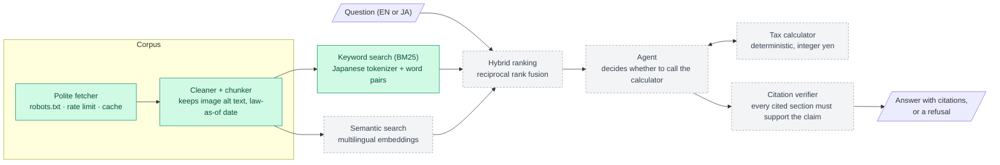

# zeimu (税務)

**Ask about Japanese inheritance and gift tax in English, get answers grounded in the official Japanese sources, with every claim cited and every number calculated by code.**

> **Not tax advice.** zeimu is an engineering project. Its answers may be wrong or out of date. Consult a licensed tax accountant (税理士) before making any decision.

## Why this is hard

Japan's National Tax Agency (国税庁) publishes clear guidance on inheritance tax (相続税) and gift tax (贈与税), but only in Japanese. An English speaker dealing with an estate in Japan needs to know what applies, how much tax is owed, and where it says so. A general-purpose chatbot is a poor fit:

- **A confident wrong answer costs real money.** Tax is computed in steps (statutory shares, a progressive rate table, then allocation by what each heir actually received). An LLM doing that arithmetic in its head will sometimes get it wrong without saying so.
- **The rules depend on the date.** For example, the window for adding lifetime gifts back into an estate is moving from 3 to 7 years, with transitional rules. An answer has to use the rule in force for the date in question.
- **The question and the source are in different languages.** An English question has to find Japanese legal text, and English answers must keep the Japanese legal term visible instead of inventing a translation.
- **The source pages hide key content.** On the NTA pages, core formulas are images whose text only appears in the HTML `alt` attribute. A standard HTML-to-text pipeline silently drops them.

## How it works



<sub>Green: built. Grey, dashed: designed, in progress.</sub>

### Design principles

zeimu is under active development. These are the rules each component is designed and tested against as it's built.

- **The model never does arithmetic.** Any number in an answer comes from the calculator or is quoted from a cited source. The calculator implements only rules stated on NTA pages and is tested against the NTA's own worked examples, plus property-based tests (tax never falls as the estate grows; heirs' shares sum to the total).
- **Cite, verify, or refuse.** Every claim cites a specific source section. A verifier checks that each citation exists, was actually retrieved for this question and supports the claim. An answer that fails is retried once, then refused.
- **Dates are first-class.** Every chunk carries the date its source law was current and when it was fetched, so date-dependent rules can be applied and checked.
- **Retrieved text is data, never instructions.** Prompt-injection defense is tested both through user questions and through a planted document in the corpus.
- **Japanese terms stay visible.** English answers show the Japanese legal term in parentheses, e.g. spouse tax reduction (配偶者の税額軽減).

## Evaluation

Accuracy is measured, not assumed. The evaluation set is designed to cover rule lookups, exact-yen calculations, English questions answered from Japanese-only sources, the same question asked in English and Japanese (the answers must agree), date-dependent rules, questions that must be refused, and prompt-injection attempts.

- **Harm-weighted critical errors** are reported separately, with a target of zero: a wrong number stated confidently, an outdated rule applied, answering when it should have refused, or a citation that doesn't support its claim.
- **Retrieval** is scored with recall@5 and MRR for BM25 alone, embeddings alone and the hybrid, so the value of each part is shown, not claimed.
- **Gold answers are written and checked by hand** against the source pages, never generated by an LLM. A held-out set is written before any tuning and used only for final reports.
- **Runs are reproducible:** temperature 0, at least 3 runs with the spread reported, and model and embedding versions recorded with every result.

Results will be published here once they have been measured.

## Engineering highlights so far

- **A polite, testable crawler.** It fetches only from an allowlisted host, obeys robots.txt (including `Crawl-delay`), spaces requests at least 1.5 s apart, identifies itself honestly, and caches every page with its fetch date and checksum. It deliberately doesn't follow redirects: the site answers missing pages with a redirect to an error page, which must never be stored as tax content. It collected 137 pages with zero failures, and later runs make no network requests.
- **A cleaner that doesn't lose the hard parts.** It detects each page's encoding (main pages are UTF-8, Q&A pages Shift_JIS), keeps formula images as their `alt` text, flattens tables so each row keeps its column headers, and drops navigation and contact boilerplate. Each page's law-as-of date (e.g. 令和8年4月1日 → 2026-04-01) and legal basis travel with every chunk.
- **Citable, stable chunks.** 137 pages become 286 chunks, one per section, with long sections split at sub-headings. Source wording is stored unchanged so it can be quoted exactly. Chunk IDs come from the heading path, not position, so a section added by the NTA doesn't change the IDs that hand-labelled evaluation cases point to. Rebuilding produces a byte-identical file, and CI checks the committed corpus.
- **Keyword search built for Japanese.** Japanese has no spaces between words, so text is split with the Sudachi morphological analyzer, which also normalizes amounts (3,000万 and its full-width form both become 30000000). Sudachi splits legal compounds such as 配偶者の税額軽減 into separate words, so the index also stores neighbouring-word pairs. A chunk containing the whole term outranks one where the same words are scattered, with no hand-maintained term list. BM25 itself is implemented from the formula and tested against a hand-worked example.
- **Fast, offline tests.** The HTTP client, clock and sleep function are injected, so rate-limiting behaviour is tested exactly, with no network and no waiting.
- **Defensive file handling.** URLs are validated before they become cache paths, so a crafted link can't write outside the cache folder.
- **Strict quality gates.** ruff, Pyrefly in strict mode and pytest run before every commit and on every pull request. CI installs from the lock file and pins third-party GitHub Actions to commit SHAs.

## Tech stack

- **In use:** Python 3.12 · uv · httpx · selectolax · Pydantic · SudachiPy · NumPy (BM25, vector search) · bge-m3 embeddings via sentence-transformers · pytest · ruff · Pyrefly · pre-commit · GitHub Actions
- **Planned:** Hypothesis · FastAPI

## Running locally

Requires [uv](https://docs.astral.sh/uv/); it installs Python 3.12 automatically.

```bash
uv sync                    # install dependencies
uv run pytest              # run the tests
uv run zeimu fetch         # download the NTA Tax Answer pages into data/raw/ (cached)
uv run zeimu chunk         # clean and split them into data/chunks.jsonl
uv run zeimu search "配偶者の税額軽減"   # keyword search over the chunks
uv run zeimu embed        # embed the chunks with bge-m3 (downloads ~2.2 GB once; ~2 min on CPU)
uv run zeimu search "spouse tax reduction" --method embed   # semantic search, works in English
```

## Sources and attribution

The corpus is built from the National Tax Agency's Tax Answer (タックスアンサー) pages on inheritance tax, gift tax and property valuation, reused under the Japanese government standard terms of use. zeimu **processes** this content (splitting, indexing, translating and summarizing it), so its output is not the government's own wording:

> 国税庁「タックスアンサー」(https://www.nta.go.jp/taxes/shiraberu/taxanswer/) を加工して作成

`data/chunks.jsonl` is processed content from these pages. Each answer links to the specific Tax Answer page it cites. No real personal data is used anywhere in this project; all examples and test cases use made-up people and amounts.
